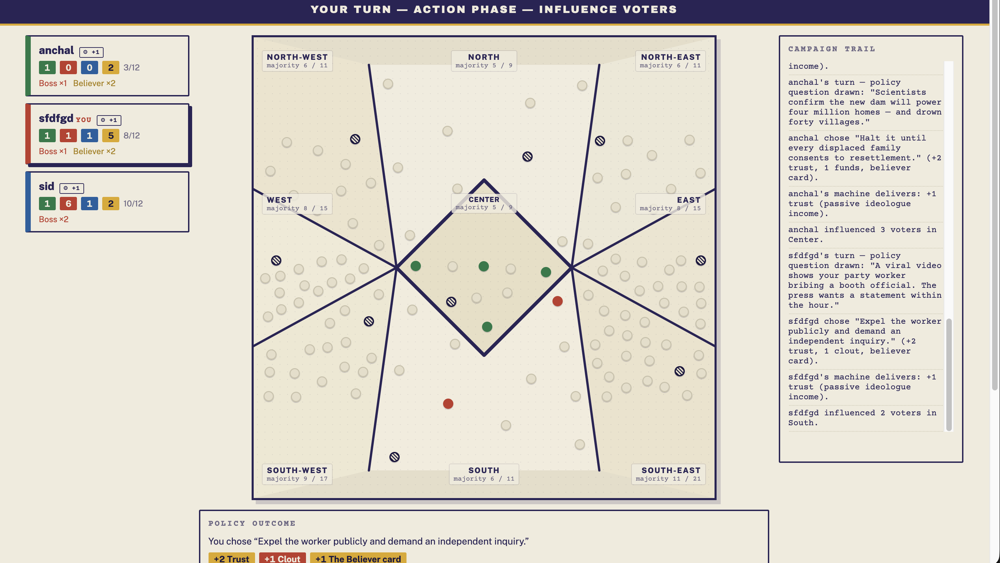
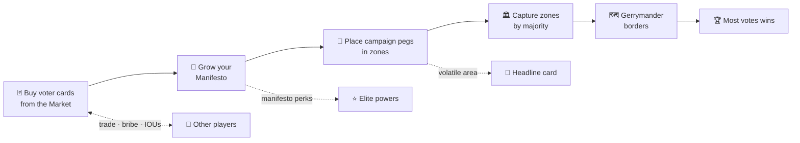
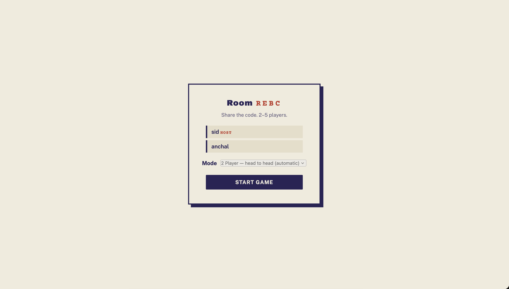
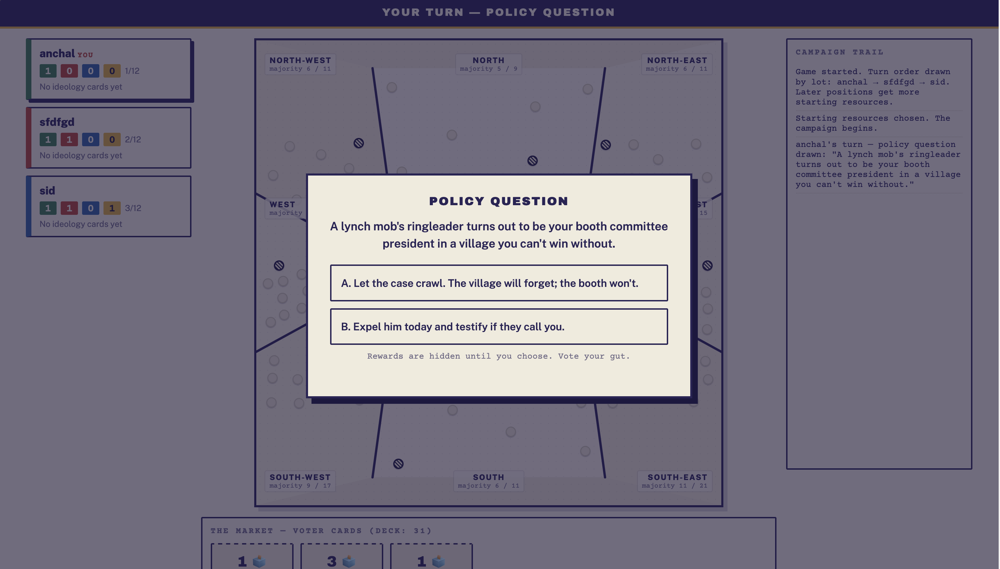
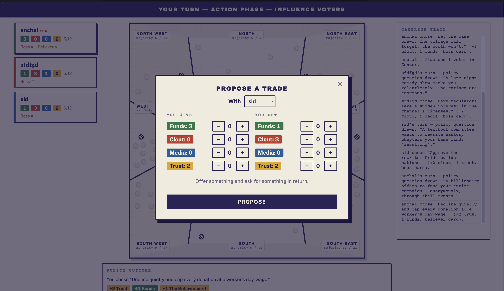
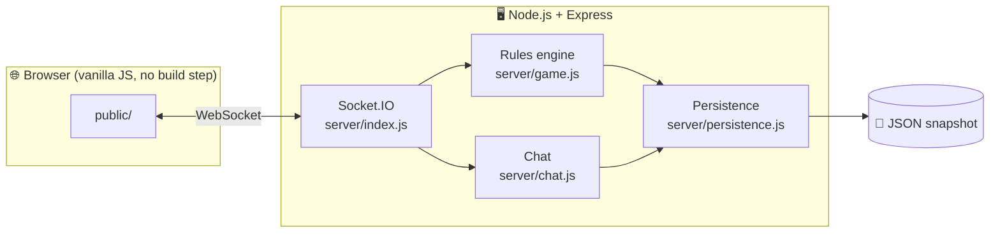

<div align="center">

# 🗳️ The System

### Win the vote. By any means necessary.

**A multiplayer political-strategy game for 2–5 players, played in the browser.**
Trade, bribe, gerrymander and conspire your way to control of 9 electoral zones.
Nothing to install.

<br>

<a href="https://buymeacoffee.com/sid.g">
  
</a>

<sub>☕ Tips pay for <b>hosting and development</b>: keeping the servers up and new features shipping.</sub>

💡 **Got an idea for a new season, campaign or mode?** [Tell me here](https://forms.gle/SnTWjgBAAtuRgmY47). It takes a minute and needs no sign-in.

<br><br>


[](https://github.com/sidharth18jam/the-system/actions/workflows/test.yml)
[](./LICENSE)

<br>



</div>

---

> [!NOTE]
> **Origin:** The System is an unofficial fan adaptation of **[SHASN](https://www.shasnthegame.com/)**,
> designed by Zain Memon and published by Memesys Culture Lab. The gameplay closely follows
> SHASN's rules. I've renamed the game, ideologies, resources and other named elements, and
> written my own card text. It is not affiliated with or endorsed by Memesys Culture Lab or
> Zain Memon. If you enjoy it, please [buy the physical game](https://www.shasnthegame.com/).

## 💡 Why this exists

A physical board game needs 2–5 people, a table, and 2–6 hours in one room. That limits who
gets to play it and how often. In a browser, anyone with a laptop or phone can play, replay
or study a game. That's also why this is an open project: it's a research and teaching tool
for area-control game design, negotiation-driven mechanics, and multiplayer web-game
architecture, which a physical box can't easily be.

---

## 🎲 How it plays

Each player picks an **ideology** and fights to win the popular vote across 9 zones on the
board. It's part area control, part social deduction, and it's played at the negotiating
table. Most of the game happens in the deals players make with each other.



### Pick your ideology

| | Ideology | Resource |
|:-:|---|---|
| 🟩 | **The Mogul** | 💰 Funds |
| 🟥 | **The Boss** | 💪 Clout |
| 🟦 | **The Icon** | 📣 Buzz |
| 🟨 | **The Believer** | 🙏 Trust |

### Key terms

| | Term | Meaning |
|:-:|---|---|
| 🏪 | **The Market** | Central board where face-up Voter Cards are displayed for purchase |
| 📜 | **Manifesto** | A player's collection of ideology cards; higher count = level-up perks |
| 🗺️ | **Constituency / Zone** | One of 9 electoral zones; captured by reaching the majority threshold |
| ✂️ | **Gerrymandering Phase** | Move a non-majority peg next to a zone where you hold the majority |
| 📰 | **Headline Card** | Event card triggered when a peg is placed in a Volatile Area |
| 🕵️ | **Conspiracy Card** | Hidden-hand card with a targeted effect on another player |
| 🧾 | **IOU** | "I Owe You" token, for debts between players and to the bank |
| ⭐ | **Elite Card** | A power that switches on automatically once your manifesto qualifies |

---

## 📸 Screenshots

<table>
  <tr>
    <td align="center"><br><b>Room lobby</b></td>
    <td align="center"><br><b>Policy question</b></td>
  </tr>
  <tr>
    <td align="center"><br><b>Board mid-game</b></td>
    <td align="center"><br><b>Proposing a trade</b></td>
  </tr>
</table>

---

## ✅ Status

> **The full rule set is implemented and playable.** Trading, gerrymandering, majority
> breaking, headlines and volatile areas, conspiracies, IOUs and auctions, manifesto perks,
> elite powers, and four game modes are all built and covered by automated tests.

| Mode | | Description |
|---|:-:|---|
| 🤝 **Coalitions** | ✅ | Two rivals capture a zone together and split its votes (3+ players) |
| 🏠 **Home Turfs** | ✅ | Each zone has its own power, usable by whoever holds its majority |
| 🎯 **Hidden Objectives** | ✅ | Everyone gets a secret goal worth bonus points |
| ⚔️ **2-Player** | ✅ | A 7-zone board, a bid for first move, and zone requirements |
| 🌀 **Edge of Chaos** | 🚧 | Not built yet |

### 👥 Playing together

| | |
|:-:|---|
| 💬 | **Chat:** a **Table** channel the whole room reads, plus a **private line** to each player for side deals. Open it from the 💬 button or from any rival's dossier. Private lines only ever reach the two people in them, history comes back when you reconnect, and an unread badge shows what you missed. |
| 📱 | **Built for phones first:** board and Market on one screen, a docked action bar in portrait, a side-by-side layout in landscape, and touch-sized targets throughout. |
| 🔗 | **Easy to join:** a 4-letter room code, a scannable invite QR, and a share link. |
| 🔄 | **You keep your seat:** reconnects automatically after a dropped connection, a locked screen or a closed tab. Lobby seats are held for 90 seconds. |
| 🔔 | **Notifications:** your turn, offers to you, conspiracies aimed at you and private messages show up as alert cards, count up in the tab title while you're away, and can trigger an opt-in system notification. |
| ⏱️ | **Nobody can stall the table:** reactions, auctions and setup steps time out and resolve automatically if a player goes quiet. |

### 📖 Learning the game

| | |
|:-:|---|
| 🎓 | **How to play:** a two-minute walkthrough, from the home screen or the lobby. |
| ⓘ | **Rule sheets everywhere:** every panel, modal and card opens a plain-language rule sheet, including one for each elite and home turf. |
| 🧭 | **Coach tips:** a one-time pointer the first time you reach each part of a turn. |

### 🚧 Still to do

- [ ] **Edge of Chaos mode**
- [ ] **Art:** all card content (150 policy cards, 36 headlines, 24 conspiracies, 13 elites, 34 voter cards) is written and in place, but none of it has illustrations yet
- [ ] **Chat moderation:** mute, block and reporting, needed before strangers play each other
- [ ] **Visible countdowns and board highlights:** timeouts run on the server but aren't shown as a clock, and board changes are highlighted in the log, not on the map

---

## 🛠️ Tech stack



- **Server:** Node.js, Express and Socket.IO. The game engine (`server/game.js`) is the
  single source of truth for all rules and uses no framework. Rooms and sockets
  (`server/index.js`) sit on top as a thin transport layer, so the engine can be fully
  unit-tested without a network.
- **Client:** vanilla JS with no build step (`public/`).
- **Persistence:** a debounced JSON snapshot saved to disk (`server/persistence.js`), so
  games in progress and chat history survive a server restart. Players reconnect
  automatically using a session token.

## 🚀 Getting started

```bash
npm install
npm start          # serves the game on http://localhost:3000
```

Open `http://localhost:3000` in 2–5 browser tabs (or on devices on the same network),
create a room, share the 4-letter code or invite QR, and play. Settings (`PORT`,
`STATE_FILE`) are listed in [`.env.example`](./.env.example).

### 🧪 Running tests

```bash
npm test           # full suite: bot-simulated games, rule invariants, modes, persistence, chat, socket e2e
```

## ☁️ Deploying

See [`DEPLOY.md`](./DEPLOY.md) for Railway, Render, Fly and Docker instructions. In short:
it's a single Node process, it needs sticky WebSocket sessions (so no scaling out behind a
buffering proxy), and it needs a mounted volume if you want game state to survive restarts.

---

## 🗂️ Repo guide

| File | Purpose |
|---|---|
| `server/game.js` | The rules engine: pure logic, no networking |
| `server/index.js` | Rooms, Socket.IO wiring, reconnect handling, timeouts |
| `server/chat.js` | Room chat: table and private channels, who can read what, limits |
| `server/persistence.js` | Saves rooms (games and chat) to disk and restores them on startup |
| `public/` | Browser client (HTML/CSS/vanilla JS); rule sheets and walkthrough in `help.js` |
| `data/*.json` | Card decks, zones and mode data, all original content |
| `test/` | Bot-simulation, rule-invariant, client-render, chat and end-to-end socket tests |

## 🤝 Contributing

See [`CONTRIBUTING.md`](./CONTRIBUTING.md) for the branch and PR workflow. In short:
branch off `main`, open a PR, get a review, squash-merge.

## 📄 License

Licensed under the [PolyForm Noncommercial License 1.0.0](./LICENSE). You're free to use,
modify and share this for any noncommercial purpose, such as personal projects, research
or education. Commercial use needs permission. Open an issue or get in touch if you want to
discuss that.

---

<div align="center">

### ☕ Enjoying The System?

<a href="https://buymeacoffee.com/sid.g">
  
</a>

<sub>Tips pay for hosting and development. It's optional and doesn't unlock anything in the game.</sub>

<br><br>

Designed and built by **[Sidharth](https://github.com/sidharth18jam)** 🇮🇳

</div>
